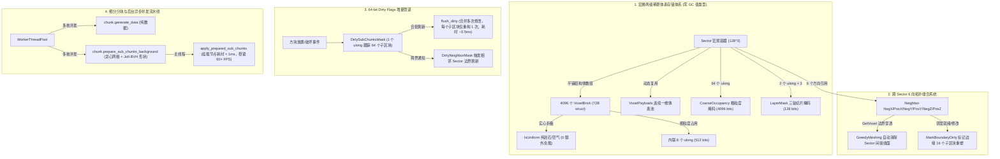
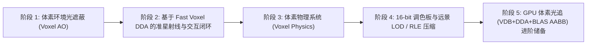

# 体素引擎技术特点与全景技术路线文档 (Architecture & Roadmap)

---

## 第一部分：当前核心技术特点 (Current Architecture & Features)

本项目基于 Godot 4.x (.NET 8 C# + GDScript)，深度融合 Caelix 引擎工业级体素架构，实现了**宏观高内聚稀疏存储**与**微观细粒度渲染/物理**的完全解耦。

---

## 第二部分：未来全景技术路线 (Future Roadmap)

### 阶段 1：体素环境光遮蔽 (Voxel Ambient Occlusion - AO)
- 4 顶点邻接遮挡计算（0~3 级暗度），无需昂贵的 SSAO 或光追，在拐角阴槽烘焙出自然的接触阴影。
- 保证贪心合并与 AO 梯度的一致性，在 `chunk.gdshader` 中通过顶点颜色 Alpha 或 UV2 实现平滑阴影渐变。

### 阶段 2：基于 Fast Voxel DDA 的准星射线与交互闭环
- 彻底绕过物理引擎三角面碰撞，使用 Amanatides-Woo Fast Voxel Traversal 算法在 3D 体素网格上实现亚微秒级射线步进，提供像素级精准的方块摧毁/建造与高亮线框。

### 阶段 3：体素物理系统 (Voxel Physics Effects)
- **重力与落沙细胞自动机 (Falling Blocks / Cellular Automata)**：
  - 沙子、砾石、泥土受重力下落与斜向滑坡堆叠。
- **结构完整性与浮空坍塌检测 (Structural Integrity & Island Detection)**：
  - 基于连通分量分析（Connected Component Flood Fill），当建筑物失去与地面的支撑连接时，悬空部分断裂并转换为轻量刚体物理掉落（Debris RigidBody3D）。
- **动态体素流体模拟 (Voxel Fluid Simulation)**：
  - 水/岩浆基于元胞自动机在体素网络中的 6 向扩散、流动与浸润计算。

### 阶段 4：16-bit Block Palette 扩展与远景 LOD / 压缩
- 扩充为 16-bit Block ID（支持 65,536 种方块），支持纹理图集索引与 PBR 通道。
- 远距离 Sector 启用粗粒度无碰撞 LOD 网格，并将体素数据压缩为 RLE 格式，支持视距 $\ge 8$ 的超大世界。

### 阶段 5：GPU 硬件光追技术储备（对标 Caelix 前沿路线）
- **架构对标**：`VDB + DDA, 8^3 的 brick 提交为 BLAS 的 AABB，然后在 intersection shader 里 dda`。
- **演进路线**：
  1. *第一步（Compute Shader 体素软光追）*：通过 Godot 4 计算着色器上传 Brick 连续缓冲区与微掩码，在屏幕空间执行 Ray Query DDA，实现软阴影与全动态漫反射。
  2. *第二步（GDExtension Vulkan RTAS）*：通过 C++ 插件直接向 Vulkan API 提交 Brick AABBs 构建硬件 BLAS，在着色器中运行 micro-DDA，达到 Caelix 原生光追性能。
